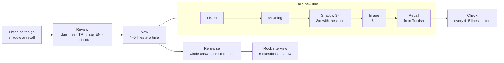

# Interview Trainer

A personal, offline study app for memorising spoken interview answers, so that recall becomes automatic in both directions: Turkish → English and English → Turkish.

It is a single-page progressive web app (PWA) served from this repository with GitHub Pages. The answer texts and the audio are encrypted; this repository only holds the built site.

## At a glance

Hear the answer, say it, recall it from Turkish, and let spaced review keep it. Everything runs on the phone, offline.



Why this order: listening and meaning introduce a line, shadowing sets its sound, the image ties it to your own life and leaves a short pause, so recall comes from memory; the check calls the lines back later and mixed, and review keeps spacing them out (1 → 3 → 8 → 20 days).

## How a day works

The **Today** tab (Bugün) lays out the day in order:

1. **Review** (Tekrar): the cards whose date has come.
2. **New** (Yeni): one group of new answers per day. One button per group chooses where new answers start: the basics (S0–S12), the preparation set (S13–S22) or the second-interview set (H1–H17). When the chosen group is finished, the others follow. "Start the next one early" adds another group the same day.
3. **Rehearse** (Prova): a suggested answer to say from start to finish.
4. **Listen on the go** (Yolda dinle): a shortcut to recall-mode listening.

## Features

### Answers, lines and groups

- Each answer is a question plus short lines (about 20 words or fewer), each with a Turkish translation.
- Every answer has a code from the source document: **S0–S12** basics, **S13–S22** preparation set, **H1–H17** second-interview set.
- Answers carry a group tag, shown as a chip and usable as a filter on every list.
- Settings uses switch rows: the whole row toggles, with a short line saying what it does.
- Listen keeps its controls compact so the card stays high on the screen: scope on one row, then value pickers (Turkish first, repeats, thinking time) and on/off chips (text, shuffle, simultaneous) on one or two rows. The idle card explains the current mode. Listen options are remembered.
- Lines are either **ezber** (word for word: openings, closings and key sentences, marked with a red edge) or **anlam** (meaning: main idea and terms are enough).
- **Pattern highlight:** each line has one or two reusable English frames (two words or more) shown in blue inside the sentence. It appears only on study screens (learning, review and speed test after reveal, Listen while the English is visible), never on blurred text, the Lines tab or rehearsal. Edited lines keep the frames their text still contains; lines added by hand get common frames picked automatically. Settings → Flow → *Pattern highlight* turns it off.
  - A line without its own frames is matched against every frame already on the device (longest first), then against a short list of common English frames; at most two. As new frames arrive with updates, such lines pick them up automatically.
  - In the edit and add forms, put a frame in **[square brackets]** to set it yourself (at most two, two words or more). Without brackets the app finds them.
- Answers can include:
  - a key sentence;
  - a skeleton or keywords (used as hints);
  - words to say clearly;
  - Turkish notes.

### Learning new answers

- Each line goes through **listen → meaning → shadow 3× → 5-second image → recall**. The first shadowing pass shows the text; the later passes hide it, and the third is said together with the voice (no gap after it).
- **Recall** (*Hatırla*): only the Turkish is shown; say the English yourself within the thinking time (the same as Listen B, by sentence length). When it runs out, or on *Show*, the English opens (patterns highlighted) and plays. *Reinforce* (↻ *Pekiştir*) runs the short fix-up below. The optional 🎤 check shows the percentage and missing words only: no suggested grade, nothing saved to the schedule. *Skip steps* skips it too.
- A short check every 4–5 lines: those lines in mixed order; see the Turkish, say the English. With 🎤 the result shows and ✓ (said it) or ↺ (ask again) is suggested; the choice stays yours.
- Why this order: listening and meaning introduce the sentence; shadowing sets sound and rhythm, and saying the third pass together with the voice adds fluency. The image ties the sentence to a scene from your own life and gives a short pause, so in Recall the sentence comes from memory, not from the echo of the last pass (use the image as the cue). The check calls the same lines back a little later and mixed; spacing and mixing make it last. Spaced review keeps doing this over the next days with growing intervals.
- **Stops** (*Niyet ve iskelet*): every line has a 1–3 word Turkish label for its job in the answer (for example "opening", "example", "result"), never its words. While learning, a stop bar above the card shows the whole answer as segments (done, current) and *Stop 4/13 · previous › current › next*. It is not shown in review, the check, Listen or the mock interview. Labels can be edited in the Lines tab; a seed update keeps a label you wrote. Settings → Flow → *Niyet ve iskelet* turns stops and the skeleton round off.
- Leaving a new-answer session (another tab, *Pause* (*Ara ver*), or closing the app) keeps the place: Today offers *Continue where you left off* at the same line or check, for the rest of the day.

- **Your own edits** (*Düzenle*): a line you changed shows *Değişti*; it opens the app's default for that line (English and Turkish) with *Varsayılana dön* to go back to it. When an update changes that default, the box says so; your text stays.

### Spaced review

- Two card types per line:
  - **TR → EN**: read or hear the Turkish, say the English aloud.
  - **EN audio → TR**: hear the English, say what it means.
- Four grades (Again, Hard, Good, Easy). Each button shows the next interval.
- **Order**: shortest interval first (cards learned or failed in the last days), then the mature ones. A day's delay costs a fresh card the most and a mature card little, so on a short day you do the fresh ones and stop; the rest come tomorrow. Cards of one interval are mixed, the answers taking turns.
- **Skip today** (*Bugün geç →*, or G, before Show): the card leaves today's list with no grade and no change to its schedule, and comes back tomorrow. A card skipped on three days in a row shows a note; a grade resets the count.
- **Reinforce** (↻ *Pekiştir*), about 20 s, the same on Recall (always), the check after a batch and review TR → EN cards (when the 🎤 result is Hard or Again): 1/3 hear the line with its text, missing pattern words marked, and say it back; 2/3 say it together with the voice, text hidden; 3/3 say it once yourself from memory (recall time; 🎤 shows the percentage only). Grades and suggestions stay from the first try. It plays the voice clip even in Siri mode. Each use is noted per line (count and date) for a later *Struggled* scope.
- The scheduler is SM-2-like:
  - intervals grow with each success, for example 1 → 3 → 8 → 20 days;
  - a miss brings the card back the same day.
- Listen-mode ✓/✗ marks and speed-test misses feed the same schedule.

### Struggled lines (*Zorlandıklarım*)

Lines you struggle with are collected here. You don't mark anything; the app adds and removes them.

- **When a line joins**: one *Again* on review adds it at once. *Hard*, Listen ✗ or *Ask again* in the check are not enough alone: a second one on the same line within about a week adds it.
- **When it leaves**: say it right on **two separate days**: Good/Easy on review, Listen ✓, or a speed-test answer in time. One ✓ is not enough, and two on the same day count once. A new struggle in between starts the count over.
- **Example**: Monday *Again* → in the list. Tuesday *Good* → 1/2. Thursday Listen ✓ → out.
- **Where**: Listen → scope *Zorlandıklarım*, and Rehearse → speed test → *Zorlandıklarım*. Hardest first, at most 15 lines.
- **Why**: a hard line sticks when it is recalled correctly on separate days in a row; one correct answer is not enough. The list stays short so it can be finished every day.
- Details: each struggle adds points (Again 3, Hard 2, ✗ 2, Ask again 2, Reinforce 1, 0.5 on Recall); a line joins at 3; points halve in a week and nothing older than two weeks counts. The first time it runs, lines that were forgotten and are still on short intervals start in the list.

### Listen

Three modes:

- **A · Shadowing**: English N times (2/3/5/7), repeat after each. The text hides after the second pass.
  - **Turkish first** (*Önce Türkçe*): *Auto* (default) plays the Turkish line once before the English only for lines not learned yet or recently forgotten, as a meaning anchor; learned lines stay English only. *Always* and *Off* are also available. Turkish never plays between passes.
  - **Simultaneous last pass** (off by default): the last pass has no repeat gap; say it together with the audio, for rhythm and stress.
- **B · Spoken recall**:
  - Turkish, then a thinking gap to say the English yourself, then English N times (1/2/3/5). The gap follows the length of the English line (the recall time, see *Timing*), can be set to short, normal or long, and counts down on the card.
  - After the English starts, two boxes in the card's top corners grade the recall:
    - **✓ known**: moves on and pushes the next review out.
    - **✗ not known**: the card returns later in the session.
  - To undo a mark: tap the filled box again, use *Undo* (shown for 5 s), or go back with *Previous*.
- **Flow** (Akış): whole answers in order, each preceded by its question.

Listen options:

- **Scope**:
  - *Due today*: lines whose date has come; modes A and B only.
  - Learned lines.
  - Everything.
  - A group: all its lines, or only the learned ones.
  - A single answer.
- **Options**: shuffle (off by default) and show text.
- **Controls**:
  - **Previous · Pause/Resume · Next** stay above the tab bar; *Finish* ends the session.
  - Headphone and lock-screen buttons (next, previous, pause) work while Listen is running, through the Media Session API.
- The screen has to stay on: a wake lock is requested, and iOS stops page audio when the screen locks.

### Timing

Every "say it" time comes from one place, so all screens agree. It follows the sentence's length and the English speech speed; the flow itself does not change.

- **Base**: 0.42 s a word ÷ speech speed. 12 words: 5 s at 1.0×, 7.2 s at 0.7×.
- **Repeat what you heard** (shadowing, Listen A): the clip's length × 1.15 + 0.6 s.
- **Say it from memory** (Recall, Listen B, the card timer, speed test): (1.5 s + base) × thinking time (short 0.75, normal 1, long 1.35), at least 3 s, no upper limit. Normal at 1.0×: 6 words ~4 s, 12 words ~6.5 s, 24 words ~11.6 s (~15.9 s at 0.7×).
- **Card timer** on review, check and speed test stays gray up to that time, then turns orange. It only informs; the grade stays yours.
- **Rehearsal** targets are never faster than about 170 words a minute.

### Rehearse and speed test

- **Answer rehearsal**:
  - Hear the question, press start and say the whole answer, then stop the timer.
  - *Show hint* reveals the keywords.
  - The result shows every line (with its stop label), the key sentence and the notes.
  - **Skeleton round** (round 1, on by default): *Start · skeleton first* gives 20 seconds to say the answer's stops in order, a few words each; then the stop list opens (or on *Show stops*) and *Start the full answer* begins the timed round. *Start without skeleton* skips it. The result shows each line's stop label. Not in later rounds or the mock interview.
  - Mark it as fluent or stuck; only that saves the rehearsal. One of the two is suggested (framed; the choice stays yours): over the round's target, or under half of the answer said with 🎤 → stuck; 85% or more said within the target → fluent. *Finish* on an unsaved result asks first. The target is 60–90 seconds without pausing.
  - **3 rounds (4/3/2)**: after the first round, tell the same answer again in less time. Round 2 aims for 85% of round 1 and round 3 for 70% (rounded to 5 seconds, never faster than about 170 words a minute). A bar shows the time left; the result lists all rounds.
  - **Follow-up questions** (on by default): after you mark an answer, a follow-up question an interviewer would ask next comes in, taken from your other answers (up to two). *End chain* stops it and shows a summary.
- **Patterns** (*Kalıp*): build a **new** sentence with a pattern from a line you have learned. A card shows the pattern, its original line and a Turkish situation (read aloud when *Read Turkish aloud* is on); say the situation in English with that pattern. *Show* opens and plays an example. With 🎤 the app checks that the pattern's fixed parts (blue) were said, in order (same word rules as the other checks), and frames *Built it* or *Couldn't*; the choice stays yours. Up to 6 patterns a session; the ones you could not build come first next time, and each pattern's situations rotate. Kept apart from the review schedule and *Struggled lines*. Patterns ship with the encrypted answer set (seed v11+) and open as their source lines are learned.
- **Mock interview**: a five-question chain like a real interview. It starts with *Tell me about yourself* (or the first answer of the chosen group), and most next questions follow up on the previous answer. In the second-interview group the last question is "Do you have any questions for me?".
- **Say and check** (🎤, Settings → Flow): on review TR → EN cards and in rehearsal, switch the keyboard to English and dictate with the keyboard microphone (or type). The browser's own speech recognition is not used: it is unreliable in Home Screen apps on iPhone, while keyboard dictation works everywhere.
  - Both texts are first brought to one form: case, punctuation, contractions (*I'm* = *I am*, also without the apostrophe), number words (*three and a half* = *3.5*, *fifteen hundred* = *1,500*), hyphens, fillers (*um*, *so*), self-corrections (*forty, sorry, fourteen* = *14*), repeated words and common dictation spellings of technical terms (*sauce* = *SaaS*, *play right* = *Playwright*).
  - **Word-for-word lines**: a weighted word error rate (numbers and negations count double, articles and prepositions half). Good from 94%, Hard from 70%. A missing word of a pattern chunk keeps it at Hard. One dropped a / an / the is Good when it is the only difference, the words are 90%+ right and it is outside the pattern chunks; the rule reads only the line's text, chunks and tier, so new and edited lines follow it too.
  - **Meaning lines**: word order and wording may differ. With *Meaning check* on, a small on-device model (natural language inference) decides whether what you said says the same as the line: same both ways = Good, part missing = Hard, contradicts = Again. With it off, content-word coverage is used.
  - **Hard checks on every line**, without any per-line data: a different number, a lost or added negation, a word turned into its opposite (*before*/*after*) and a reversed *from … to*, *instead of* or *expected … got* make the suggestion Again and are named in the result.
  - On review the result shows the suggestion, the reasons and the missing or different words; the grade stays your choice. In rehearsal each line gets its own percentage.
- **Meaning check** (Settings, experimental): turned on once; downloads about 55 MB (the model and its runtime), then works offline.
  - *Hızı ölç* (Settings → Meaning check) measures the model on this device with ten made-up sentence pairs and gives a short report to copy: app version, OS and browser version, load time, first check, median and slowest of the other nine, and the median of the last 20 real checks (only their durations are kept, only while the model is on). No sentences, no names.
- **Speed test**:
  - See the Turkish, say the English, reveal.
  - The target is correct and in time: within the line's recall time (see *Timing*). Older results were counted with a flat 3 seconds and keep that label.
  - Results keep the accuracy and median time, and misses go to today's review.
- Both can be narrowed to one group.

### Lines tab

- **List**:
  - each answer shows its code, tag, status (✓ learned, +N lines still to learn, #N place in the new-answer queue) and line count;
  - opening an answer shows its hints and notes.
- **Editing**:
  - Edit a line's English, Turkish or type, add lines, or delete lines.
  - Changing a line's English resets that line's review history.
  - Edits survive updates.
- **Export to Notes**: copies the text, English only or Turkish + English, for iOS Speak Screen.

### Audio

- English clips use the Kokoro *Fenrir* voice and Turkish clips use the macOS Siri voice. Both are pre-generated. Separate English and Turkish speed sliders (0.60–1.50, step 0.05) apply to the clips, to clips voiced on the device and to the device voice, keeping the pitch (English default 0.9, Turkish 1.0); the say-it-back gaps follow the clip's real length. In Siri mode the iPhone's own speed applies.
- A line without a clip falls back to the device voice.
- Optional on-device voicing: new or edited English lines are generated in the browser with Kokoro.
  - Turned on once in Settings.
  - Downloads a model of about 115 MB, then works offline.
- An alternative *Siri* mode keeps the page silent and lets Apple Spoken Content read the selected sentence.

### Offline, privacy and updates

- Installable to the home screen. A service worker caches the app shell, so the app works offline.
- **Install drawer**: in a browser tab a sheet slides up from the bottom with the icon, the name and one line of text. Chrome and Edge (Android and desktop): the browser's `beforeinstallprompt` is held back and the sheet's *Yükle* opens the browser's own install dialog. iPhone/iPad Safari (no such event): the same sheet with two steps, Share → Add to Home Screen; Mac Safari: File → Add to Dock. Firefox: none. *Kapat* (or cancelling the browser dialog) hides it for 7 days; never shown in the installed app or over the passphrase screen. The manifest carries a description and screenshots for the browser dialog. Each browser and installed app keeps its own progress and key; on iPhone a Safari tab and the Home Screen app are separate.
- **Updates and version**: an open page does not update itself; the next launch (or a reload) finds the new version and reloads once, progress kept. Settings ends with the version (v0.NN until the core tasks are done, then v1), its UTC build time and the answer-set version.
- **Screen stays on while studying** (Screen Wake Lock; Home Screen apps on iOS 18.4+): during any study session and while Listen plays. It is let go after 5 minutes without a touch (not while Listen plays) and taken again when the app returns to the front or on the next touch.
- The answers and audio packs are encrypted with AES-GCM, using a key derived from a passphrase (PBKDF2-SHA256, 200,000 iterations).
  - The passphrase is asked once per device; the derived key is then kept on that device.
- Progress (review state, rehearsals, tests and settings) stays in the browser's local storage on each device.
  - It moves between devices with an export/import code in Settings.
  - *Reset progress* (Settings → Save) clears the review schedule, learned lines, rehearsals, tests and daily counts, after typing a confirmation word. Answers, edits, settings, audio and the passphrase stay. A backup is kept on the device, so the reset can be undone.
- **Answer updates are merged**, not replaced:
  - new answers and lines are added;
  - lines changed upstream replace the old ones;
  - lines you edited or added are kept, and lines you deleted stay deleted;
  - review progress is untouched.
- **Audio packs are append-only.** An update downloads only the new pack, and earlier packs stay cached.

## Shortcuts

| Where | Keys (Mac) |
|---|---|
| Review | Space/Enter = reveal · 1–4 = grade |
| New answer check | Space = reveal · 1 = ask again · 2 = said it |
| Speed test | Space = reveal · 1 = wrong · 2 = right |
| Patterns (*Kalıp*) | Space/Enter = show the example · 1 = couldn't · 2 = built it |
| Rehearsal, skeleton round | Space/Enter = show the stops · then start the full answer |
| Reinforce (*Pekiştir*) | P = open (when its button shows) · inside: Space/Enter = show (3/3) or back to the card · R = one more round · Esc = leave. Keys go by position, so they work on any keyboard layout. |
| Listen | ← previous · → next · Space = pause/resume |
| Listen, mode B | 1 = ✗ not known · 2 = ✓ known |
| Headphones / lock screen | next · previous · pause (while Listen is running) |

On AirPods, double and triple tap can be set to next/previous track in the iPhone's Bluetooth settings.

## Files

| File | What it is |
|---|---|
| `index.html` | The whole app: markup, styles, script, the encrypted answer set and the audio pack list |
| `sw.js` | Service worker for offline use |
| `audio.bin`, `audio-*.bin` | Encrypted audio packs |
| `tts/` | Browser bundle for optional on-device voicing (kokoro-js with the ONNX Runtime Web WebAssembly files) |
| `nli/` | Transformers.js and its ONNX Runtime Web WebAssembly files for the optional meaning check (the model itself is fetched once from Hugging Face) |
| `manifest.webmanifest`, `icon-*.png` | Home-screen install |
| `dev/` | Not used by the app: tests and maintenance tools (below) |

## Development

- `dev/lib/verify3.js` is the spoken check. `index.html` carries a copy between `verify3:start` and `verify3:end`; after changing the file run `node dev/tools/sync-verify3.cjs` (a test fails if they differ).
- `dev/lib/seed.cjs` decrypts and re-encrypts the answer set the same way the app does. The passphrase is passed in, never stored.
- Tests use Playwright (`@playwright/test`) and contain no answer text:

  ```
  cd dev && npm i --no-save @playwright/test@1.63 && npx playwright install chromium && cd ..
  TRAINER_PASS=<passphrase> dev/node_modules/.bin/playwright test -c dev/playwright.config.cjs
  ```

  Optional: `TRAINER_MODELS=<folder with Xenova/mobilebert-uncased-mnli>` runs the meaning-model test offline (`TRAINER_MODELS=online` downloads it instead); `TRAINER_DATA=<private folder>` adds private real-sentence fixtures. Tests that need what is not set are skipped.

## Credits

- [kokoro-js](https://github.com/hexgrad/kokoro) and the Kokoro-82M model (Apache-2.0).
- [Transformers.js](https://github.com/huggingface/transformers.js) (Apache-2.0) and the MNLI-tuned MobileBERT model [Xenova/mobilebert-uncased-mnli](https://huggingface.co/Xenova/mobilebert-uncased-mnli) (an ONNX export of typeform/mobilebert-uncased-mnli, based on Google's MobileBERT, Apache-2.0; the fine-tuned model card states no license of its own).
- [ONNX Runtime Web](https://github.com/microsoft/onnxruntime) (MIT).
- Fonts from Google Fonts: Bricolage Grotesque, IBM Plex Sans and IBM Plex Mono (SIL OFL).
